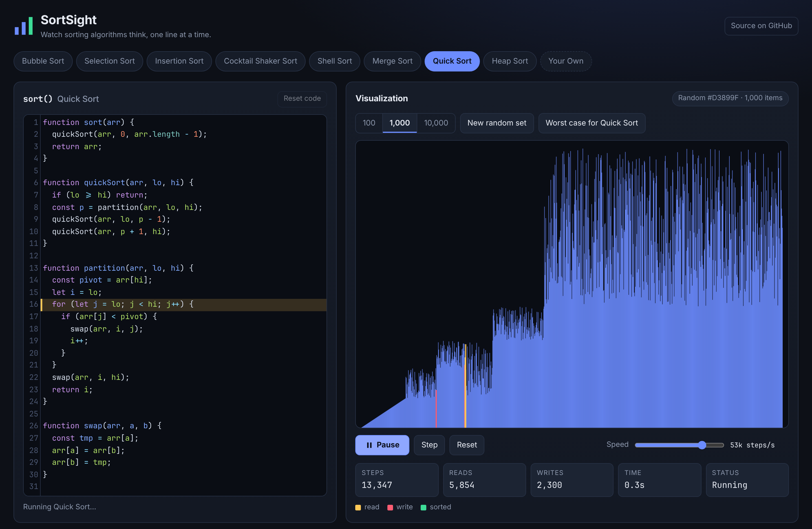

# SortSight

**Watch sorting algorithms think, one line at a time.**

SortSight is an interactive sorting-algorithm visualizer that runs entirely in the browser and is hosted on GitHub Pages.

**Live site:** https://mendus59.github.io/SortSight/



## Features

- **Eight built-in algorithms**: Bubble, Selection, Insertion, Cocktail Shaker, Shell, Merge, Quick and Heap Sort, plus a blank slate for your own.
- **Live code highlighting**: each algorithm's `sort()` function is shown beside the chart, and the line that is running right now is highlighted.
- **Editable code**: change any algorithm, or write your own `function sort(arr)`, and press Play to watch your version run. Edits are saved in your browser.
- **Canvas bar chart** for 100, 1,000 or 10,000 items. Reads are shown in amber, writes in red, and the bars turn green when the array is sorted.
- **Play / Pause, Step and Reset**, with a speed slider from 1 step per second up to "Max".
- **Worst-case data sets** for every algorithm (for example, sorted input for last-pivot Quick Sort). The panel explains why the set is a worst case and shows every value. You can also paste your own values.
- **Fair comparisons**: a data set keeps its original order when you switch algorithms, so every sort starts from the same input. Finished runs go into a comparison table, and **Run every sort on this set** benchmarks all of them at once.
- **Whiteboard tutorials** (`tutorial.html`): a plain-English, hand-drawn lesson for each sort, aimed at people who have never written code. Marker-sketched blocks hop and swap on a whiteboard while a handwritten caption explains every step. Play, pause, step, scrub, and choose a speed.
- **Complexity panel** with best, average and worst time, space, and stability for each algorithm.

## How it works

Your code is never run on the page itself:

1. `js/instrument.js` parses the code with [Acorn](https://github.com/acornjs/acorn) and rewrites it into a generator. A `yield <line>` goes in front of every statement and at the top of every loop iteration, and calls between your functions are turned into trampolined calls.
2. `js/runner.js` steps that generator inside a **Web Worker** (`js/worker.js`). Recursion uses an explicit stack, so even 10,000-deep Quick Sort recursion can't overflow. The array is wrapped in a `Proxy` that counts reads and writes.
3. The page asks the worker for N steps per animation frame and redraws the canvas from a snapshot. If the worker doesn't answer within 3 seconds (for example, an infinite loop inside a callback), it is terminated. Bad code can't freeze the page.

The chart uses one rectangle per pixel column when there are more bars than pixels. Each column is drawn solid up to its smallest value and translucent up to its largest, so 10,000 items render quickly and unsorted regions are still visible.

### Writing your own sort

```js
function sort(arr) {
  // sort arr in place (or return a new sorted array)
  return arr;
}
```

Declare helpers with `function name() {}` or `const name = function () {}`, and they get step-through highlighting too. Code inside arrow functions runs, but it isn't stepped line by line.

## Running locally

There is no build step. Serve the folder with any static server:

```sh
npm start          # or: python3 -m http.server 8080
npm test           # Node 20+; checks every algorithm and the instrumenter
```

## Deploying

`.github/workflows/pages.yml` runs the tests on every push and pull request. On `main` it also deploys the site to GitHub Pages. One-time setup: **Settings → Pages → Build and deployment → Source: GitHub Actions**.

## Project layout

```
index.html            page shell
tutorial.html         whiteboard tutorials (js/tutorial/: lessons.js scripts, board.js + sketch.js drawing, main.js player)
css/style.css         styles
js/main.js            UI, playback loop, comparison table
js/algorithms.js      algorithm code, complexities, worst-case generators
js/instrument.js      source-to-generator rewriter
js/runner.js          stepping engine (shared by worker and tests)
js/worker.js          Web Worker sandbox
js/renderer.js        canvas bar chart
js/datasets.js        seeded random sets and value parsing
vendor/               Acorn and CodeMirror 5 (MIT)
tests/                node:test suite
PORTFOLIO.md          summary for the personal website
```
